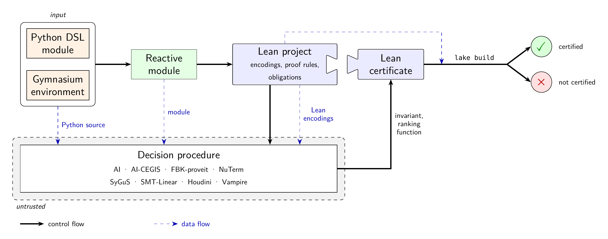

# `verith` — inferring the certificate

`reactor` (the [`python/`](../python/reactor/lean/README.md) project) turns a reactive module and a
property into a Lean project whose `lake build` checks a proof of the
property, given the proof's certificate: an inductive invariant, and for a
Büchi property a ranking function. This project finds the certificate.

It holds three packages:

| package | what it is |
|---|---|
| `verith` | the inference routes -- one package per route (`verith/<name>/`), the table over them (`verith/__init__.py`) -- and the `verith` command |
| `certify` | the `certify` command: `reactor` and `verith` in one run, in one process |
| `nuterm` | the learner `--infer nuterm` trains, with its own command (`python -m nuterm`) and Lean library |

All three are built on `reactor`, and `reactor` imports none of them
(`python/tests/test_layering.py`, `tests/test_layering.py`). What a route
needs of a project `reactor` generates -- the encodings it reads, the
lakefile entries it adds, the files it owns -- it declares as data on its
row, and the commands here hand that to `reactor`.



A `certify` run: `reactor`'s stages, with the decision procedure -- the
route, untrusted -- between the project and the certificate. Solid arrows
are the run's control flow. Dashed ones are data: what the decision
procedure may read, and the project that the check builds the certificate
in. Its source is [`figures/pipeline.tex`](figures/pipeline.tex).

## Three commands

| command | project | what it does |
|---|---|---|
| `reactor` | `python/` | the module and the claim in, the Lean project out, with the certificate given by `--invariant` / `--ranking` (or `sorry`) |
| `verith` | `verith/` | the module and the claim in, the certificate out: printed in the input's names, as `--invariant` and `--ranking` take it (`--json` for a program) |
| `certify` | `verith/` | both: `reactor`'s flags and `--infer`; the project is generated, the route runs against it, and the certificate is rewritten from its answer |

```bash
cd verith

# infer, and print what was found
uv run verith ../python/tests/fixtures/svcomp_countdown.py \
    --buchi "(= (X @intf.0) 0)" --infer houdini
# .. The certificate, in the input's names:
#    --invariant '(<= 0 (X @intf.0))'
#    --ranking '(X @intf.0)'

# ... and hand it to reactor, which writes and builds the project
uv run reactor ../python/tests/fixtures/svcomp_countdown.py \
    --buchi "(= (X @intf.0) 0)" \
    --invariant '(<= 0 (X @intf.0))' --ranking '(X @intf.0)' \
    --build-cert -o out/ -p Countdown

# or both in one run
uv run certify ../python/tests/fixtures/svcomp_countdown.py \
    --buchi "(= (X @intf.0) 0)" --infer houdini --build-cert -o out/ -p Countdown
```

`certify` is the command that was `verith` before the routes moved here,
with the same flags and the same output; `reactor` is it without `--infer`.

### `verith`

`verith` reads the module, the claim and the SMT budget with the flags
`reactor` reads them with, and the route with the flags `certify` takes:
a command line moves between the three by adding or dropping flags.

A route whose row reads or writes the generated project needs one: the LLM
routes prompt on its Lean, and `fbk-proveit` installs a certificate in it.
`--project DIR` names a project `reactor` (or `certify`) generated from the
same module -- `DIR` is `-o`'s directory joined with `-p`'s name -- and
`verith` refuses one generated from another module (its `dbg/system.txt`
differs). Without `--project` such a route is refused before it runs.

With a project, every route also reads and writes its `artifacts/`, so a
`verith` run continues where the last run in that project left off, as a
`certify` run does; `--artifacts use|ignore|reset` is as for `reactor`. A
route that answers with files (`fbk-proveit`) writes them into the project,
and adds what its row declares to the project's lakefile; nothing else of
the project is rewritten. `certify` is what rewrites the certificate from
an answer.

`--json` prints one object on stdout -- `route`, `kind`, `returns`,
`invariant` and `ranking` in the input's names, `smt` in the internal ones,
`lean` for a route that answers in Lean, `files` for one that answers with
files -- and everything the route logs on stderr.

## The routes

`--infer NAME` runs one route. A route is a package that exports a `ROUTE`
row. The row says what the route may read and write in the project, which
`artifacts/` it resumes from, and what it returns: predicates in SMT-LIB,
predicates in Lean, or whole files. The run holds each answer to its row
and believes nothing else about it: whatever a route answers is written
into the project, and Lean checks it.

| route | LLM | returns | how it finds the certificate |
|---|---|---|---|
| `ai` | yes | Lean | one call proposes the invariant and the ranking function; a second call is asked to find them wrong |
| `ai-cegis` (default `--infer`) | yes | SMT-LIB | each candidate is put to the obligations in cvc5, and a counterexample goes back into the next prompt |
| `nuterm` | no | SMT-LIB | a ranking function trained on rollouts and certified by Farkas/CEGAR; the invariant comes from Houdini |
| `sygus` | no | SMT-LIB | cvc5's SyGuS invariant track, over linear facts and congruences |
| `smt-linear` | no | SMT-LIB | one cvc5 query per shape; a refuted query proves that no certificate of that shape exists |
| `houdini` | no | SMT-LIB | facts read off simulated runs, kept only once cvc5 or Vampire proves them |
| `vampire` | no | SMT-LIB | the certificate is left as holes in the obligations, and Vampire's answer fills them |
| `fbk-proveit` | no | files | `lean-ltl-certifying`'s ic3ia toolchain, over an NA model of the module |

[Inferring with an LLM](#inferring-with-an-llm) shows the LLM routes. The
others each have a section, from [`--infer nuterm`](#inferring-without-an-llm---infer-nuterm)
to [`--infer fbk-proveit`](#certifying-through-lean-ltl-certifying---infer-fbk-proveit).
[Adding an Inference Route](#adding-an-inference-route) says how to write a
new one.

### Flags

`certify` takes every flag of `reactor`'s ([Key flags](../python/reactor/lean/README.md#key-flags));
`verith` takes its input, claim, `--artifacts` and `--smt-timeout`/`--smt-budget`
flags, and neither the project's (`-o`, `-p`, `-x`) nor the outputs'. Besides
those they take:

| Flag | Default | Description |
|------|---------|-------------|
| `--project` | — | `verith` only: the generated project a route reads or writes |
| `--json` | off | `verith` only: the answer as JSON on stdout |
| `--infer` | — | Which route finds the certificate: `ai`, `ai-cegis` (default when the flag is given without a value), `nuterm`, `sygus`, `smt-linear`, `houdini`, `vampire`, or `fbk-proveit`. `verith` requires it |
| `--model` | `claude-sonnet-4-6` | `--infer ai` and `--infer ai-cegis`: the LLM model to ask |
| `--base-url` | — | `--infer ai` and `--infer ai-cegis`: an OpenAI-compatible endpoint, for local LLMs |
| `--sygus-grammar` | `congruence` | `--infer sygus`: what an atom of the synthesised invariant may be; `linear` drops the `(= (mod … k) 0)` atoms |
| `--sygus-conjuncts` | `3` | `--infer sygus`: a ceiling on how many atoms the invariant may be a conjunction of, tried `1, 2, … N` — the bound is what makes each space finite, and so decidably empty |
| `--linear-rows` | `2` | `--infer smt-linear --safety`: how many linear inequalities the invariant may be a conjunction of |
| `--houdini-solver` | `cvc5` | `--infer houdini`: which solver decides the obligations. `cvc5` needs no binary and refutes what it cannot prove, with a counterexample; `vampire` refutes or times out |
| `--houdini-timeout` | `120` | `--infer houdini`: seconds for all solver calls together; each call is capped at 2 s, then the rest (under `vampire`: 2 s, 10 s, 60 s, then the rest) |
| `--vampire` | `$VAMPIRE`, then `vampire` on PATH | `--infer vampire` and `--houdini-solver vampire`: the Vampire binary, or a directory holding one |
| `--vampire-timeout` | `120` | `--infer vampire`: seconds for all answer-literal calls together; one call per template, and a template that does not answer is not retried |
| `--vampire-cores` | `4` | `--houdini-solver vampire`: processes each call's portfolio spreads over |
| `--proveit-dir` | — | `--infer fbk-proveit`: path to a `lean-ltl-certifying` checkout |
| `--ic3ia` | — | `--infer fbk-proveit`: path to the `ic3ia` binary, forwarded to `proveit.py` |
| `--fbk-simplify` | `cvc5` | `--infer fbk-proveit`: `none` leaves the NA model's transition the shape the module's own terms give it |

Each route is one row of `verith.ROUTES`, and a flag below `--infer`
belongs to a route: passed without its route selected it is an error, not
a no-op. `--fbk-proveit DIR` is the older spelling of `--infer fbk-proveit
--proveit-dir DIR` and still works.

## Inferring with an LLM

```bash
# AI inference with Claude (requires ANTHROPIC_API_KEY + pip install verith[ai])
uv run certify mymodule.py --buchi "(= (X @intf.0) 0)" --infer -o out/ -p MyProject

# ... and for a safety property, through the cvc5-checked loop
uv run certify mymodule.py --safety "(<= (X @intf.0) 10)" --infer ai-cegis -o out/ -p MyProject

# AI inference with a local LLM via Ollama (requires pip install verith[ai-local])
uv run certify mymodule.py --buchi "(= (X @intf.0) 0)" --infer \
    --model qwen3-coder --base-url http://localhost:11434/v1 \
    -o out/ -p MyProject
```

Both LLM routes prompt on the project's functional encoding, so `verith`
runs them only with `--project`.

## Inferring without an LLM (`--infer nuterm`)

`--infer nuterm` searches for the certificate the way a termination prover
does, and proves it before offering it:

1. **The invariant** — Houdini over a candidate lattice of sign and pairwise
   facts (`nuterm/_invariants.py`): seed the candidates, drop the
   ones that do not hold at entry or are not preserved by a step, and certify
   the survivors as one inductive `Safety` claim.  With `--safety`, the
   property itself is seeded as a candidate, so it is an invariant exactly
   when it survives with the rest.
2. **The ranking function** (`--buchi` only) — a small ReLU network is trained
   on rollouts of the module to drop on the rounds where the property does not
   hold, its weights are rounded to integers, and the candidate is composed
   into the module as two ordinary atoms, `V(s)` and `V(s')`.  The obligation
   `V(s) - V(s') >= 1` on that domain goes to a decision procedure over the
   composed module's wires: Farkas-certified linear regions, with CEGAR
   finding the regions (`nuterm/_farkas.py`).  Only a candidate it
   certifies is returned.

So unlike the `ai` routes, what reaches the certificate has already been
proved — `--pre-check cvc5` and `lake build Certificate` confirm it rather
than discovering it.  The trade is reach:

| | `--infer nuterm` | `--infer ai-cegis` | `--infer fbk-proveit` |
|---|---|---|---|
| needs | nothing but the repo | an API key or a local LLM | an `ic3ia` build and a `lean-ltl-certifying` checkout |
| state it reads | scalar integers | whatever cvc5 encodes | whatever the NA encoding expresses |
| property | `--safety` or `--buchi` | `--safety` or `--buchi` | `--safety` |
| invariants it can find | Houdini's lattice | whatever the LLM proposes and cvc5 confirms | ic3ia's interpolants |
| deterministic | yes (a fixed seed) | no | yes |

The procedure refuses by name what it has no rule for — a matrix-shaped or
real-valued component, a next value that reads an awaited input, an operation
with no cell rule — rather than degrading quietly.  `--invariant`,
`--ranking` and `--pre` are rejected alongside it: the route computes the
whole certificate, and its invariant holds at entry for *every* input, which
is stronger than any precondition would make it.

## Searching a shape instead of proposing one (`--infer smt-linear`, `--infer sygus`)

Two more routes need no LLM, and they differ from `nuterm` in what they do
when they fail.  Both fix the *space* the certificate may live in and hand
it to cvc5 a width at a time, narrowest first, so "not found" is an answer
with content: what is decided is decided about a width that was reached.

* **`--infer smt-linear`** fixes the shape and leaves the coefficients open,
  which makes the search one query — `exists c. forall s. obligations(c . s)`.
  Every scalar component is a column whatever its sort: an `Int` is itself, a
  `Bool` is `0`/`1` (`(ite s0 1 0)`), a bitvector is its unsigned value
  (`(ubv_to_int s0)`) — so a Bool-state module, which `--infer nuterm`
  refuses, is in reach, and so is a BitVec one.
  `--buchi` asks it for a ranking function `c0 + c1*s0 + …` over a fixed
  invariant (supplied with `--invariant`, resumed from `artifacts/`, or
  `true`); `--safety` asks it for the invariant itself, as a conjunction of
  `a0 + a1*s0 + … >= 0` rows, one width at a time up to `--linear-rows`.
* **`--infer sygus`** (`--safety` only) fixes a *grammar* instead and hands
  cvc5's SyGuS invariant track the three formulas `G P` is made of:
  `addSygusInvConstraint(inv, pre, trans, post)`.  Its grammar carries
  congruences — `(= (mod a0 + a1*s0 + … k) 0)` — which is the one fact
  Houdini's lattice cannot state, and the reason the route exists beside
  `nuterm`.  The conjunction is bounded (`--sygus-conjuncts`, default 3),
  which bounds the certificate and, more to the point, makes the space
  *finite*: cvc5 can then report it empty rather than merely unsearched.
  The widths run `1, 2, … N` and the first that answers wins, because the
  search is **not monotone in the width** — measured over the 59 matrix
  cells that reach the grammar, two modules have a one-atom invariant found
  in under a second that the three-atom query does not finish.  Asked only
  at the ceiling the route found 28 and decided 1 space empty; a width at a
  time it finds 31 and decides 22.

**A refuted search is a proof, and it is kept.**  When the template query
comes back `unsat`, nothing of that shape satisfies the obligations — a fact
about the module, not a failure to look.  It is written to `artifacts/` as a
`no_solution` note, and `--infer ai-cegis` reads those notes into its prompt
on the next run, so an attempt is not spent proposing what a decision
procedure has already ruled out.  A search that runs out of budget writes an
`unknown` note instead and is *not* carried into any prompt: the difference
between a proof and a timeout is the whole value of the note.

```bash
# 1. the cheap question first: is there a linear ranking function at all?
uv run certify m_toward5.py --buchi "(= (X @intf.0) 5)" \
    --invariant "(and (>= (X @intf.0) 0) (<= (X @intf.0) 10))" --infer smt-linear -o out/ -p Rea
# error: --infer: ... No ranking function linear in the state ... cvc5 refuted
# the whole shape at once ... so this is a proof that the space is empty.

# 2. the expensive one, now knowing that
uv run certify m_toward5.py --buchi "(= (X @intf.0) 5)" \
    --invariant "(and (>= (X @intf.0) 0) (<= (X @intf.0) 10))" --infer ai-cegis -o out/ -p Rea
# .. resuming from note-0003-smt-linear.md: a space an earlier run ruled out
```

The same workspace carries what was *found*.  `--infer sygus` writes its
invariant as a resumable `inv`, so the next run takes it as given:

```bash
uv run certify m_step2.py --safety "(not (= (X @intf.0) 1))" --infer sygus -o out/ -p Rea
# [sygus] inv: (= (mod (+ (- 2) (* (- 1) s0)) 2) 0)        -- `x` is even

uv run certify m_step2.py --safety "(not (= (X @intf.0) 1))" --infer ai-cegis \
    --pre-check cvc5 -o out/ -p Rea
# .. resuming from inv-0002-sygus.smt2 (proved): taking it as the certificate
# [CEGIS] all obligations UNSAT — accepted        -- and no LLM call was made
```

What each is for, measured on the `python/tests/limits` fixtures:

| | `--infer smt-linear` | `--infer sygus` |
|---|---|---|
| property | `--safety` or `--buchi` | `--safety` |
| finds | coefficients of a fixed shape | any term its grammar generates |
| answers `no` | yes, as a proof — 2–30 ms for a ranking function | yes, as a proof — each bounded grammar is finite (10–166 ms), and the note claims the widest width that finished |
| cost | milliseconds per width; a second invariant row can cost more than 30 s | 11 ms for `m_step2`'s congruence; a width that finds nothing costs the per-query budget, and there are `--sygus-conjuncts` of them |
| engine | one quantified query, or — when cvc5 will not state it, which a bitvector column always does — a counterexample loop over a bounded coefficient box | cvc5's SyGuS invariant track |
| state it reads | scalar `Int`, `Bool` and `BitVec` | scalar integers, transition in `LIA` |
| seeds | `--invariant` (strengthened, not replaced), `--pre` | `--pre` |

Neither is a better `nuterm`: within the scalar-integer class they overlap
with it and lose on ranking functions, where a learned rank handles shapes a
linear template has no room for.  What they add is the *no*, and one
invariant shape — a congruence — that nothing else here can state.

## Proposing candidates and proving them (`--infer houdini`)

This route does not search for a certificate. It *proposes* — candidates that
hold on simulated runs of the module — and a solver decides what stays:

* **invariant** — Houdini over facts that hold on simulated runs of the
  module: bounds stated with the program's own constants, congruences,
  sums and differences of two components against zero, bounds on each side
  of a Bool flag, the values a Real component keeps to, and under
  `--safety` the property's conjuncts.
* **ranking function** — affine forms of one or two components, `K*x + y`,
  and piecewise `(ite c f g)` over the conditions the property and
  transition branch on and the order of each pair of components. Each is
  shifted to be positive on the rounds where the property fails and offered
  zeroed where it holds.
* **smaller certificate** — the unsat cores name the facts a proof used;
  the invariant handed on is their closure, then minimised one fact at a
  time. Both solvers report one.

### Which solver (`--houdini-solver`)

The obligations are quantifier-free — the inputs are free constants, so what
an obligation quantifies over is its free variables — and what is left is
linear integer and real arithmetic with `to_int`, `div`, `mod` and `ite`.
Two solvers answer them, and the difference is one thing:

| | `cvc5` (default) | `vampire` |
|---|---|---|
| binary | none — it is the package that encoded the module | `--vampire`, `$VAMPIRE`, or on `PATH` |
| a candidate it cannot prove | **refuted, with a counterexample** | out of time, or false — indistinguishable |
| a failed Houdini pass | one model names every fact to drop: **one call** | one call per fact |
| a refuted candidate | gone for the run | retried at the next rung |
| per-call limits | 2 s, then the rest of `--houdini-timeout` | 2 s, 10 s, 60 s, then the rest |

[Vampire](https://github.com/vprover/vampire) is a first-order theorem
prover that reads SMT-LIB. Handed the negation of an obligation it either
refutes it — the obligation holds — or runs out of time: it never answers
*false* and never returns a model. cvc5 *decides* these obligations, so
`sat` is a counterexample, and a counterexample holds at every time limit
there will ever be.

That is why the ladder of per-call limits differs. Vampire's `smtcomp`
portfolio divides its limit among its strategies, so a short limit is a
different schedule rather than a truncated long one, and a whole search runs
at one limit before the next is tried. cvc5's search at a longer limit
simply contains the shorter one, so its rungs are only a cap that stops one
query eating a whole budget. Either way a repeated pass re-asks only what
came back unanswered — a proof or a refutation already in hand is kept.

Measured on the 399 obligations of certificates the benchmark matrix had
verified, Vampire's portfolio refuted 369 within 2 s, nearly all in
10–20 ms; the rest were encodings it cannot read or obligations that were
false — that is, nothing in that corpus needed a first-order prover rather
than a decision procedure.

### What both solvers get

Because a false candidate can cost a whole time limit, nothing is put to a
solver that a sampled round refutes: states near the reached ones — and from
a range far wider than the program's constants, which is what exposes a
shift fitted to small numbers — where the invariant holds, with inputs as
`--pre` allows. On `ChenFlurMukhopadhyay-SAS2012-Ex3.01` the wide sample
took the ranking search from 46 Vampire calls and 84 s to 3 calls and 0.1 s.
It stays on both solvers: it is cheaper than a call either way, and it is
what makes the *candidates* good rather than only the answers. A `--safety`
property a run of the module violates is reported as not holding, before any
solver is started.

```bash
uv run certify mymodule.py --buchi "(= (X @intf.0) 0)" --infer houdini -o out/ -p Rea
# [houdini] solver: cvc5
# [houdini] Houdini kept 2 of 2: (<= 0 s0) (<= s0 100)
# [houdini] ranking function proved: s0
# [houdini] invariant cut to the 1 of 2 facts its proofs use
```

It reads scalar `Int`, `Bool` and `Real` state and inputs, whichever solver
is chosen: Vampire has no bitvector theory, and cvc5 has one but the
candidate shapes above do not, so a bitvector is refused by name for both
and a matrix-shaped component is refused as it is by `smt-linear`. A tuple
the transition builds internally is folded away by cvc5's rewriter before
Vampire sees it. When nothing is found, the note in `artifacts/` says
`unknown`, not `no_solution`: even under cvc5, what was refuted is the
candidates proposed, not the space they were drawn from.

A `Real` component changes two things. Its invariant is a **set of values**
rather than an interval, because over the reals a bound is hardly ever
inductive — `m_lra_lin` steps `x' = x - 1` while `x > 0`, so `0 ≤ x ≤ 5`
admits `x = 1/2` and steps it out — while the values a run takes are
finitely many and closed under the round. And its ranking function is
**scaled, then floored**: `rule_buchi` ranks by a `Nat`, so a real rank is
read through `to_int`, and a quantity that falls by less than one need not
floor to a smaller number. The scale is the least common denominator of the
literals the program writes, so `m_lra_half`, which steps by a half, is
ranked by `(to_int (* 2.0 s0))`. Literals are written as decimals
throughout: Vampire's front end sorts them strictly and reads neither
cvc5's `(/ 1 2)` nor a bare `3` where a `Real` belongs, and cvc5 reads a
decimal as happily, so the certificate carries one spelling whoever proved
it.

```bash
uv run certify ../python/tests/limits/mods/m_lra_lin.py --buchi "(= (X @intf.0) 0.0)" \
    --infer houdini --houdini-solver vampire --vampire ~/vampire/vampire \
    -o out/ -p Rea
# [houdini] solver: vampire
# [houdini] Real state: a ranking function is floored after scaling by 1
# [houdini] inv: (or (= s0 0.0) (= s0 1.0) ... (= s0 5.0))
# [houdini] ranking: (to_int s0)
```


## Deriving the certificate outright (`--infer vampire`)

Where `--infer houdini` proposes candidates and asks a solver which survive,
this route proposes nothing. It states the obligations with the certificate
*itself* left open — a template whose coefficients are existentially
quantified — and asks Vampire for the coefficients:

```
(assert-not (exists ((A0 Int) (B0 Int)) (and ... )))
% SZS answers Tuple [([1,100]|[0,100]|[0,100])|_] for cert
```

which carries `0 <= s0 <= 100`, derived rather than checked. That is
Vampire's *answer literal* mechanism (`--question_answering plain`): it
refutes the negation of the conjecture and reports the substitutions the
refutation used. Those alternatives are a **disjunctive** answer — one of
them is a witness, not each of them, because a split refutation closes each
branch under its own hypothesis — so every one is tried against the
obligations and the one they accept is the certificate. Here the first,
`1 <= s0 <= 100`, is not preserved: `s0 = 1` steps to `0`.

The question is not printed by this route. The obligations are cvc5 terms —
the module's own encoding, the same terms `--infer houdini` proves — so the
conjecture is *built* as one cvc5 term, holes and quantifiers and all, and
cvc5 prints it as SMT-LIB. `assert-not` is what marks the formula that
`--question_answering` attaches answer literals to; an ordinary negated
assertion is refuted without an answer.

The templates are tried smallest first — `A_i <= s_i <= B_i` per component,
then the same plus `C_ij <= s_i - s_j <= D_ij` for each pair.

### Two holes at a time

Two holes is what the answer-literal search closes; three is a time limit.
So the questions are kept to two where they can be:

* `--safety` is **one** question. `inv -> prp` is what pins the interval
  down, and with it the coefficients are two.
* `--buchi` is **two**: an inductive invariant, then a ranking function that
  drops on *that* invariant, with its coefficients already numbers. The
  joint question is four holes for a one-component module and answered
  nothing at all over `python/tests/limits`; the split derives `m_countdown` and
  `m_deep` — invariant in about a second, rank in about eight. The rank
  obligation is `rank(s) > 0` where the property fails and `rank(s') <
  rank(s)`, which implies the clamped `Int.toNat` form `rule_buchi` asks
  for.

Splitting a search can cost what a joint one would have found — an
inductive invariant need not admit a rank, and the second question cannot go
back and ask for another. So every alternative of the first answer is
carried into the second.

An invariant asked for on its own is *looser* than one asked for with the
property, and loose is harder: with nothing pinning the interval the search
is over the whole of `Int`, and `m_countdown`'s invariant-only question does
not come back inside 30 s. Bounded to a window around the module's own
constants (`program_constants`, the same seed Houdini uses) it answers
`[0,100]` in three. The same window costs the safety questions `m_max` and
`m_toward5`, whose obligations pin the interval already — so it is asked for
where it is needed and nowhere else.

### What the question has to look like

Two restrictions, both measured on `m_countdown`, and the first decides the
shape of the whole route.

**No `ite`, anywhere.** Stated with the transition as one conditional, the
step obligation does not come back inside 40 s; split into its two guarded
branches it is answered in under a second. So the transition is
*branch-split* before it is printed: every `ite` condition the update and
the init terms mention becomes a case, cvc5's rewriter folds the
conditionals away under each assignment, and each case is one more
implication with its guard as a hypothesis. The round and the initial state
are split apart, because they are not quantified over the same things — a
guard from the round tests the latched state, which the entry obligation
does not have.

**Not the portfolio.** `--mode portfolio --schedule casc` reaches the time
limit on this route's own question where the default mode answers at once. A
portfolio strategy is tuned to find a refutation; what is wanted here is the
*substitution* a refutation carries.

**Both namings, and the whole budget declared to each.** Vampire introduces
a Tseitin definition for each subformula it judges worth naming, and on a
conjecture with holes that is decisive in *both* directions: over
`python/tests/limits` at 30 s each, naming answers `m_max` and `m_toward5` where
`--naming 0` does not, `--naming 0` answers `m_relu` where naming does not,
and they agree on `m_countdown`, `m_deep` and `m_min`. So both are asked,
each on a share of what is left of the run.

And `--time_limit` is a *scheduling* input before it is a cap — Vampire
slices it between strategies, so a small one runs a different search rather
than the same one cut short. `m_max`'s question reaches the limit at
`--time_limit 20` and answers after 2.5 s at 25. So every call declares the
run's whole budget and the wall clock is what actually bounds it.

### The reach

Small, and worth knowing before reaching for it. Vampire's answer-literal
search closes the **two-hole** question and does not close a three-hole one:
adding a third, otherwise-free hole to the `m_countdown` question above
turns an instant answer into a time limit. Five option settings were tried
against that ceiling — `-qago on`, `--saturation_algorithm otter`, `--saturation_algorithm
lrs`, `--theory_instantiation all`, `--unification_with_abstraction
one_side_interpreted` — and none moved either.

So in practice this route derives a certificate for a **one-component Int**
module — eight of seventeen `python/tests/limits` safety and Büchi pairs, two of
them Büchi — and refuses past that pointing at `--infer houdini`, which
searches a wider module by proposing facts and proving them. It reads scalar `Int` state
only: Vampire reads reals, but the templates here are integer intervals and
integer coefficients.

### What comes back is checked

An answer literal is the substitution *a* refutation used, and this route
wrote the question it refuted. So the coefficients are put back into the
template and the obligations are re-asked of cvc5 — through the same seam
`--infer houdini` uses, in milliseconds. A certificate that does not survive
that is reported as not found. This is not Houdini: nothing is filtered and
nothing is proposed; it is the one check that the derivation is honest.

```bash
uv run certify ../python/tests/limits/mods/m_countdown.py --safety "(<= (X @intf.0) 100)" \
    --infer vampire --vampire ~/zeroth/vampire/vampire -o out/ -p Rea
# [vampire] 2 branch(es) of the round, 1 of the initial state, 1 component(s)
# [vampire] template intervals: 2 holes, 409 chars
# [vampire] answered with naming
# [vampire] Vampire answered A0=0, B0=100
# [vampire] inv: (and (<= 0 s0) (<= s0 100))
```

---

## Certifying through `lean-ltl-certifying` (`--infer fbk-proveit`)

`--fbk-proveit=<dir>` swaps the other routes' invariant machinery for the
`proveit.py` driver of the [`lean-ltl-certifying`][ltl] repository, which
model-checks the system with ic3ia and renders the inductive invariant it
finds back as a Lean certificate:

```bash
uv run certify mymodule.py --safety "(not (= (X @intf.0) 15))" -o out/ -p Counter \
    --fbk-proveit ~/zeroth/proof-prototyping/lean-ltl-certifying \
    --ic3ia ~/ic3ia/build/ic3ia
```

Add `--build-cert` to have the certificate compiled rather than merely
written (see [Building the certificate](../python/reactor/lean/README.md#building-the-certificate---build-cert)).

```
mymodule.py ──certify─▶ out/Counter/                       (bare, as usual)
                        out/Counter/ProveIt/CounterNA.lean (the NA encoding)
                                  │
                                  ▼   proveit.py
                        lean2vmt ─▶ ic3ia ─▶ vmt2lean
                                  │
                                  ▼
                        out/Counter/ProveIt/CounterCert.lean
                                  │
                                  ▼   two tactic patches; handed back to the pipeline
                        out/Counter/Certificate/Certificate.lean
```

The installed file is the project's *own* certificate — the same
`Certificate/Certificate.lean` that `Certificate.lean` root-imports and that
`lake build Certificate` reaches, overwriting the `sorry` stub the bare
project would have carried. The route does not write it: it hands the text
back in `InferResult.files`, with `Certificate/Equivalence.lean`, and the
pipeline writes both through the route's `ProjectHandle`. For the reach to
end in a build rather than an unknown identifier, the row's `lakefile` hook
gives the project two lakefile entries:

| lakefile entry | resolves |
|---|---|
| `[[require]] name = "LTL_Certifying", path = <checkout>` | `import LTLCertifying.Safety.Lemmas` and its two siblings. A path require because the route already holds the checkout, and because that checkout pins `cslib` and `smt` to the revisions the generated project already requires — the two package sets resolve as one |
| `[[lean_lib]] name = "<Proj>NA", srcDir = "ProveIt"` | `import <Proj>NA`. `proveit.py` compiles an out-of-tree model into an olean and imports it under the file *stem*, so the stem is the module name the certificate carries; the lib maps it back onto `ProveIt/<Proj>NA.lean`. `fbk.proveit.na_module_name` is the single owner of that name, used to write the model and to declare the lib |

`import Smt` needs nothing new — `reactor`'s project already requires
`smt` — and neither does the cvc5 shared library the `smt` tactic dlopens:
lean-cvc5 declares `precompileModules := true`, so `lake build` loads it
without the `--plugin=` that `proveit.py` has to pass to a bare `lean`.

Of the *invariant* the project is still **bare**: it comes from ic3ia, so
`--infer`, `--invariant`, `--ranking` and `--pre` are rejected rather than
silently ignored, and `--safety` is required.

### Encoding 6 — NA, for the FBK toolchain (`verith/fbk_proveit/na.py`)

`proveit.py`'s first step, `lake exe lean2vmt`, pattern-matches on a very
specific Lean shape. This encoding is emitted only for that route, and is
not one of the five above — though the project does build it, as the
`<Proj>NA` lean_lib, because the certificate imports it:

| `lean2vmt` requires | why | what it would otherwise get |
|---|---|---|
| binders `state` / `statenext` | `emitDefs` looks them up by name to tell current from next | `state`, `newstate`, `s` |
| state read as `var_i state` | `exprToSMT`'s `.fvar` case returns the bare binder name and **drops the index**, collapsing every slot onto one variable | `(state i)` |
| next state as `var_i statenext` | this is how `collectLatchesIndices` finds the latches at all | `(newstate i)` |
| `INIT` / `TRANS` / `PROPERTY` | they become `:init`, `:trans`, `:invar-property` | `InitCond`, `TransRel`, nothing |
| top-level `StateType`, `abbrev M : … NA …` | the certificate template imports the model and names both | everything inside a namespace |
| self-contained imports | it is elaborated inside the `lean-ltl-certifying` package | imports `Relational.Basic`, `System.Scalar`, … |

The right-hand column is what the project's own Bool-valued relational
encoding emitted. That encoding — `System/FBK.lean`, one of six until this
one replaced it — missed every row, which is why the two could never be the
same file; nothing else read it, so it is gone and its name is here.

The property is translated to **`Bool`**-valued Lean (`&&`, `!`,
`decide (… ≤ …)`), not the `Prop` form `smt_to_lean` emits: `lean2vmt` reads
`decide`'s *instance* argument, so `decide` applied to a compound proposition
hands it `instDecidableAnd`, which it prints as an unapplied leaf.  `>` / `≥`
are normalised to `<` / `≤` with swapped operands for the same reason.

### What the route refuses

Everything `lean2vmt`/`vmt2lean.py` cannot represent aborts with a non-zero
exit instead of producing a transition system that parses but does not
describe the module:

| rejected | because |
|---|---|
| external input wires | `lean2vmt` models only `state`/`statenext` |
| state elements other than `Int`/`Bool` | `vmt2lean.py`'s `tp()` maps back only those two |
| — | a state *mixing* `Int` and `Bool` is fine: `TypeMap` gets an arm per slot, and the `TypeMap.match_1` the equation compiler generates never reaches the VMT, because `emitDefs` keeps only declarations whose return type whnfs to `Prop`/`Int`/`Bool` |
| — | a ctrl wire *wider* than 1×1 is fine too, and used to be the largest refusal here: the state is flattened to one VMT variable per **element**, so `R_k` compares two scalars where it once would have compared two tuples |
| an op `smt.encode` has no term for (`Transpose`, `Uninterpreted`) | the transition is `smt.encode`'s term for each element, printed by `smt_to_lean_bool` — no term, no model |
| an op the Bool printer cannot render | same boundary from the other side: the printer raises rather than emit something `exprToSMT` would misread. `Linear`, `Argmax`, `Max`/`Min`, `Xor` and `Ne` all pass it — as an affine sum, a nested `ite` chain, `max`/`min`, `!(a == b)` and a negated equality — which is why they are no longer refused |
| — | `Ne`, `ReLU`, `Max` and `Min` need a `lean2vmt` carrying the commit *"translate mod, max/min and a negated decidable instance"*; against an older one they go back to being printed as `instDecidableNot` / `max` / `min` |
| a property outside that same fragment | ditto — `smt_to_lean_bool` raises rather than guess. `mod` is refused here even though `lean2vmt` translates it and ic3ia proves such a property: MathSAT eliminates the mod from the *witness*, as `x + (-2) * to_int ((1/2) * to_real x) = 0`, and `vmt2lean.py` renders neither those operators nor a Real inside a `Bool` `INVAR` |
| `lake` missing, `mathsat` not importable, `proveit.py` failing or writing nothing | checked before and after the subprocess |

The transition itself is not written by `verith/fbk_proveit/na.py`. Each
state slot's next value is `smt.encode`'s term for that element — the
encoder `--pre-check` and `--infer ai-cegis` run on — simplified by cvc5 and
printed by
`smt_to_lean_bool`. So the model `lean2vmt` reads and the obligations cvc5
answers about the same module are one encoding rather than two readings, and
the refusal list above is exactly what those two components cannot express.

**`--fbk-simplify none`** turns the rewriter off. It is a spelling, not a
semantics: a module whose update reads `if x + 1 = 10 then 0 else x + 1`
emits

```lean
-- default
abbrev effect_0 (state : StateType) : Int :=
  (if ((var_0 state) == (9 : Int)) then (0 : Int) else ((1 : Int) + (var_0 state)))
-- --fbk-simplify none
abbrev effect_0 (state : StateType) : Int :=
  (if (((var_0 state) + (1 : Int)) == (10 : Int)) then (0 : Int) else ((var_0 state) + (1 : Int)))
```

— the same transition, and only the second one can be read against the
source. Bool slots are never simplified either way, for a reason worth
knowing: the rewriter turns `ite c b (¬b)` into an equality, which moves the
slot from a branch into a *condition*, and `vmt2lean`'s `generalizeNatVar`
then retypes it to the unreduced `TypeMap` match where the `Decidable`
instance cannot be synthesised. What the rewriter buys on the arithmetic is
size: a 32-wide affine layer is 97 KB of term unfolded and 1.9 KB folded, so
`none` is for reading small models, not for running the sweep.

Two limits are by design rather than by defect. First, the model's imports
are `lake build`-ed before `proveit.py` runs: `lean2vmt` elaborates the model
with `processHeader`, so they must already exist as oleans, and `lake exe
lean2vmt` builds only the executable (whose own imports are just `Lean`).
The model imports `Cslib.Computability.Automata.NA.Basic` and nothing else —
`M`'s type is all it needs — so that pre-build is one target;
`NA_IMPORTS` and `fbk.proveit._LAKE_TARGETS` are the same list, pinned by a
test, because drift between them leaves `lean2vmt` unable to elaborate.
Second, the installed certificate is by default **written but not
compiled** — not because the project cannot compile it (it can: the lakefile
requires the checkout and declares the NA lib) but because doing so resolves
and builds Mathlib. That is `--build-cert`, which is not this route's flag:
see [Building the certificate](../python/reactor/lean/README.md#building-the-certificate---build-cert).

### The `lean-ltl-certifying` side

The route needs that checkout on the same toolchain as the generated
projects, **v4.34.0**. It is kept there by matching `project/lakefile.py`'s
package set exactly (`cslib v4.34.0`, `smt db545be…`, Mathlib inherited
through cslib), which lets one already-built `.lake/packages` — e.g.
`python/tests/lean`'s — serve both.

The port from v4.28.0 needed, on the `smt` path this route uses, the move
of `Mathlib.Logic.Basic` to `Mathlib.Basic.Logic.Basic` and one `simp at ih`
in `Safety/Lemmas` that no longer makes progress. On the SAT path
(`vmt2lean -m sat`, which `NACounterBoolTS_cert` and `lmcs06mutex0` are
built on), `bv_decide_light` was a copy of the `bv_decide` frontend with a
lighter rewrite pass. v4.34 rewrote that frontend, and its rewrite pass is
now the light one, so the tactic is `bv_decide`. The SAT template no longer
turns off `andFlattening` and `embeddedConstraintSubst`: on the new frontend
they are what keeps the SAT problem small, and `lmcs06mutex0` builds in 83 s
with them rather than 169 s without. The port from v4.27.0 before that fixed
the same tactic: without `bvSimprocs` the `Bool` structure of a hypothesis
reached the bitblaster unnormalised and it reported a "potentially spurious
counterexample".

[ltl]: https://github.com/zeroth/proof-prototyping

---

## Adding an Inference Route

Every way a certificate can be inferred is one row of
`verith.ROUTES`, and `--infer <name>` selects a row.  A route is one
package, `verith/<name>/`: its `__init__.py` exports `ROUTE` (an
`InferRoute`), its `engine.py` is what the row runs, and its entry in the
`ROUTES` tuple of `verith/__init__.py` is the only line written elsewhere.
`verith.flags` reads the rows for both commands, so the `--infer` choices, the help text, every
cross-flag rule and the dispatch all follow from the row rather than from
an edit apiece.  The row imports its engine inside `run`, so
`verith --help` imports none of them; no route imports another, and an
option two rows share is declared once in `verith/common/options.py`.  The
types a row is written in are in `verith/route.py` (the row) and
`verith/io.py` (what a route is given and hands back).

A row says:

* **the property** — `kinds` (`"safety"`, `"buchi"`, or both) and
  `kinds_refusal`, the sentence printed when the property is the other one.
  The check is generic and the reason is not: why the `ai` route cannot
  certify `G P` is prose about `rule_globally`, and why `nuterm` discards a
  precondition is prose about Houdini.
* **what it seeds from** — `seeds`, the given predicates it will *use*
  rather than discard, and `seeds_refusal`.  A predicate outside the
  set is refused where it is passed, not dropped four steps later.
* **the project** — `reads` (encoding suffixes; `""` is the functional one)
  and `owns` (project-relative paths it may write).  The route is handed a
  `ProjectHandle`, so these two are the whole of its access, and a route
  that needs more of the project than the predicates says which more.
* **the input** — `reads_source`: the route is handed the file the module
  was read from (`InferInput.source`, a `SourceText`) and the names claims
  may use (`InferInput.names`). A route that does not declare it gets
  `None` for both.
* **`artifacts/`** — `reads_artifacts`, the roles it may resume from.  It is
  declared access, like `reads`: `ProjectHandle.resume(role, …)` refuses an
  undeclared role, and the filtering (stale module, stale property, stale
  proof rule, plus the languages and statuses asked for) is the store's, so
  there is one filter and one place that reports what it dropped.
* **the hooks** — `resolve` at parse time (a route whose lakefile names a
  path has to reject a bad one before any of the project exists),
  `lakefile(config, project_name)`, the `LakefileParts` (extra `lean_lib`s
  and `require`s) the project is generated with, `precheck` once the module
  is loaded and before it is generated (a module shape the route cannot
  express is met there rather than as a traceback out of an encoder it never
  wanted; it is handed the run's encoding), and `run`.
* **what comes back** — `returns`: `"smt"` (SMT-LIB predicates, which
  `--pre-check` can restate the obligations from), `"lean"` (nothing parses
  it back, so they cannot be restated), or `"files"` (the certificate is a
  file the route produced, with no predicates behind it).  The row
  *declares* it and the `InferResult` carries it, and `main` checks the two
  agree once rather than each reader trusting whichever is nearer to hand.
* **its own flags** — `options`, a tuple of `Opt`.  Passed without the route
  selected, each is an error rather than a no-op.  `aliases` carries any
  older spelling that selects the route and fills one of those options
  (`--fbk-proveit DIR`), so a deprecated flag goes away with its row.

A route is handed a frozen `InferInput` — the `Claim`, the `given`
predicates it starts from, the run's encoding and budget — and answers with
a new `InferResult`: SMT-LIB in `cert`, which the pipeline prints as Lean in
one place (`proof.render.render_certificate`), or, for the one `returns="lean"` row
(`ai`), Lean in `lean`.  `files` carries whole files the route produced
(project-relative path to text); the pipeline writes them after the
predicates, through the handle, so each has to be a path the row owns.
`fbk-proveit` answers with its certificate and the proof that its model is
the module this way.  A route that resumes from `artifacts/` reads it through
`ProjectHandle.resume`; the two that take an invariant an earlier run proved
as given do so through `verith.resume` (`resumable_inv`, `taking_inv`, and
`ruled_out` for the shapes an earlier search proved empty).

`tests/test_infer_routes.py` checks the table the way `test_lean_ops.py`
checks the op matrix: a row declaring an encoding no row emits, an artifact
role that is not one, a refusal with no reason, or two routes claiming one
flag fails there rather than in generated code.

## Tests

`just vr-test` (`uv run pytest -m 'not slow'` from `verith/`) runs
`tests/` and `nuterm/tests/`; `just test-lean` adds the `slow` ones, which
build Lean. The modules they run on are `reactor`'s fixtures, read from
`python/tests/` (`fixtures/`, `smv_fixtures/`, `limits/mods/`).
`tests/bench_matrix/` measures every route on every benchmark
([README](tests/bench_matrix/README.md)), `tests/fbk/` sweeps the
`fbk-proveit` route ([README](tests/fbk/README.md)), and
`scripts/route_transcripts.py` records `certify` transcripts to diff a
refactor against.

A change to `reactor` is checked here too. Record each of these at the
commit before it and after it, and compare:

- **Route transcripts**: `uv run python scripts/route_transcripts.py OUTDIR`,
  then `diff -r`. 42 `certify` runs over all eight routes, with the LLM
  replies scripted; the docstring names the variables that find the
  external tools. Record on a quiet machine, and re-run a `vampire_*` case
  alone before reading a difference in it as a change: under load its
  templates run out of their shared deadline.
- **Encoding snapshots**: `scripts/encoding_snapshots.py OUTDIR` writes what
  the transcripts do not cover: the `System/*.lean` encodings, the bare
  `--cert-file` certificate, and the NA model and bridge, per fixture.
- **Goldens**: `tests/test_certify_golden.py`; `REACTOR_UPDATE_GOLDEN=1`
  rewrites them. Set `VAMPIRE` to the binary for the Vampire tests.
